<p align="center">
  
</p>

# 🤖 Awesome AI Computer Use & OS Automation Ecosystem

<p align="center">
  <a href="https://github.com/ishandutta2007/Awesome-Awesome-Awesome"></a>
  <a href="https://discord.gg/jc4xtF58Ve"></a>
  <a href="https://github.com/ishandutta2007/Awesome-AI-Computer-Use-OS-Automation/stargazers"></a>
  <a href="https://github.com/ishandutta2007/Awesome-AI-Computer-Use-OS-Automation/network/members"></a>
  <a href="https://github.com/ishandutta2007/Awesome-AI-Computer-Use-OS-Automation/blob/main/LICENSE"></a>
  <a href="https://github.com/ishandutta2007"></a>
</p>

---

## 🌟 Top AI Computer Use, GUI Vision-Action Agents & OS Automation Ecosystem

> ⚡ **A comprehensive, SEO-indexed, curated repository of production SaaS platforms and open-source GitHub projects for autonomous Computer Use, GUI agents, desktop OS automation, headless browser control, and sandboxed virtual desktops.**

**Keywords**: *Computer Use, GUI Agent, OS Automation, Multimodal Vision-Language-Action (VLA), Anthropic Computer Use, OpenAI Operator, Agent S, UI-TARS, Browser-Use, Screen Grounding, RPA, Playwright, Headless Browser, Virtual Desktops, X11 Sandboxing, Desktop Copilot.*

📅 **Last updated: November 2026**

---

## 📑 Table of Contents

- [📊 Sector Overview & Market Dynamics](#-sector-overview--market-dynamics)
- [🏢 SaaS & Hosted Platforms](#-saas--hosted-platforms)
- [💻 Open-Source GitHub Projects](#-open-source-github-projects)
- [🛠 Architectural Stacks for Custom Systems](#-architectural-stacks-for-custom-systems)
- [📈 Star History](#-star-history)
- [💖 Support & Sponsorship](#-support--sponsorship)
- [🤝 How to Contribute](#-how-to-contribute)
- [⚖️ Disclaimer](#-disclaimer)

---

## 📊 Sector Overview & Market Dynamics

The **AI agents and autonomous computer-use automation** market is valued at approximately **$7.0B–$8.0B in 2025** and is projected to expand exponentially past **$50B by 2030** (growing at a compound annual growth rate of ~43–46%). 

The industry demonstrates a two-tiered market structure:
1. **Foundational Frontier Layer (Concentrated / Winner-Take-Most)**: Dominated by major foundation model labs (e.g., Anthropic, OpenAI) that control the compute-intensive multimodal vision-action backbones, screenshot grounding, and token economies.
2. **Execution & Virtualization Infrastructure (Moderately to Highly Fragmented)**: Highly dynamic competition across specialized cloud desktop VMs (e.g., Browserbase, Orgo), vertical workflow automation agents (e.g., Lindy, Induced AI), and rapid open-source community innovations (e.g., Browser-Use, UI-TARS, Open Interpreter).

---

## 🏢 SaaS & Hosted Platforms

A quantitative comparison of commercial platforms offering autonomous computer use, cloud browser agents, and sandboxed virtual desktop infrastructure. Sorted by company valuation / scale (descending).

| Platform | Company Valuation / Scale | Starting Pricing Tier | Free Tier Limits / Free Trial | Core Capabilities & Focus |
| :--- | :--- | :--- | :--- | :--- |
| **[Anthropic Computer Use (Claude API)](https://anthropic.com)** | ~$1.51T valuation (post-IPO) / ~$33B+ revenue | $3.00 / MTok input, $15.00 / MTok output (Claude 3.5 Sonnet / 3.7 Sonnet) | $5 one-time initial credit on account signup (expires after 14 days) | Multimodal API model natively outputting OS pixel coordinates, mouse clicks, keystrokes, and bash commands |
| **[OpenAI Operator & Computer-Using Agent (CUA)](https://openai.com)** | ~$1.25T valuation / ~$13.1B+ revenue | $200.00/month (ChatGPT Pro subscription required for Operator access) | Free plan includes standard ChatGPT text/web access; Operator GUI agent includes 0 free runs (requires Pro subscription) | Reinforcement-learned autonomous GUI and browser navigation agent system operating web applications |
| **[Adept](https://adept.ai)** | ~$1.00B peak valuation ($415M funding; core team acqui-hired / tech licensed by Amazon for $25M) | $20.00/user/month (standard enterprise pilot baseline) | 14-day free trial limited to 50 automated browser runs | Enterprise multimodal action models (ACT-1) automating business web applications and legacy software interfaces |
| **[Browserbase](https://browserbase.com)** | $300M valuation ($67.5M total funding raised) | $20.00/month (Developer Plan; includes 100 browser hours, overage at $0.12/hr) | 1 browser-hour/month, max 3 concurrent sessions, 15 min session limit, 3 agent runs, 1,000 search/fetch calls | Serverless headless browser infrastructure and session replay built specifically for AI agents and Playwright |
| **[MultiOn](https://multion.ai)** | $100M valuation ($20M total funding raised) | $20.00/month (Pro Tier) | 20 agent actions/day free on web extension / dashboard | Autonomous web agent platform executing multi-step form-filling, research, and transactional workflows |
| **[Lindy](https://lindy.ai)** | ~$50M total funding raised (valuation private) | $29.99/user/month (Plus Plan; 3,000 monthly credits) | 7-day free trial with $50 free credits (no credit card required upfront) | No-code autonomous AI coworker platform managing computer-use, browser navigation, and API workflows |
| **[Simular](https://simular.ai)** | ~$26.5M total funding raised (valuation private) | $50.00/month (Starter Tier with cloud virtual computer access) | 10 agent credits/day (refreshes daily; max 5 min session limit on shared Linux/web sandbox) | Cloud and desktop computer-use agent (Sai) running Agent S hierarchical cross-platform OS architecture |
| **[Induced AI](https://induced.ai)** | ~$2.3M seed funding raised (valuation private) | $49.00/month (Starter tier; 200 browser execution minutes) | 7-day free trial limited to 30 browser execution minutes and 1 concurrent worker | Autonomous cloud-browser RPA converting natural-language prompts into parallelized web task executions |
| **[HyperWrite (Personal Assistant)](https://hyperwriteai.com)** | ~$2.8M seed funding raised (valuation private) | $19.99/month (Premium Plan; 250 AI assistant messages/month) | Free plan limited to 15 generations/month and 5 autonomous assistant actions/month | Consumer and professional AI browser companion automating web research, ordering, and form actions |
| **[Scrapybara / Orgo Cloud](https://orgo.ai)** | ~$500K+ YC funding (valuation private) | $29.00/month (Starter tier; includes 50 VM hours, overage at $0.10/hr) | $5 one-time starting credit (equivalent to ~10 hours on a Medium Linux sandbox) | Instant, API-controllable Linux and Windows virtual desktop sandboxes tailored for Computer-Use AI agents |

---

## 💻 Open-Source GitHub Projects

The open-source ecosystem provides battle-tested building blocks across screen grounding, local desktop control, containerized virtual desktops, and web navigation. 

All repositories are sorted by **GitHub Stars_Count (descending)**. Every repository badge links directly to its live stargazers page.

- **[Significant-Gravitas/AutoGPT](https://github.com/Significant-Gravitas/AutoGPT)** [](https://github.com/Significant-Gravitas/AutoGPT/stargazers)  
  Autonomous general-purpose AI agent architecture with continuous execution, web browsing, file management, and plugin-driven desktop/system automation.

- **[browser-use/browser-use](https://github.com/browser-use/browser-use)** [](https://github.com/browser-use/browser-use/stargazers)  
  Fast, leading open-source (`MIT`) web-agent framework connecting vision-language models directly to Playwright browsers via indexed DOM element parsing and visual extraction.

- **[microsoft/playwright](https://github.com/microsoft/playwright)** [](https://github.com/microsoft/playwright/stargazers)  
  High-performance browser automation library supporting Chromium, Firefox, and WebKit across Windows, macOS, and Linux; foundational backbone for web computer-use agents.

- **[OpenInterpreter/open-interpreter](https://github.com/OpenInterpreter/open-interpreter)** [](https://github.com/OpenInterpreter/open-interpreter/stargazers)  
  Widely adopted open-source (`AGPL-3.0`) natural-language interface allowing LLMs to control your local computer, execute terminal scripts (Python, Bash, AppleScript), and run GUI automation.

- **[microsoft/playwright-mcp](https://github.com/microsoft/playwright-mcp)** [](https://github.com/microsoft/playwright-mcp/stargazers)  
  Official Playwright Model Context Protocol (MCP) server enabling AI agents to control browser sessions, take accessibility snapshots, click elements, and fill inputs deterministically.

- **[trycua/cua](https://github.com/trycua/cua)** [](https://github.com/trycua/cua/stargazers)  
  Comprehensive open-source (`MIT`) Computer-Use Agent framework and high-speed virtualization sandbox (`Lume`) enabling local and cloud vision models to safely control full operating systems.

- **[microsoft/OmniParser](https://github.com/microsoft/OmniParser)** [](https://github.com/microsoft/OmniParser/stargazers)  
  Screen-parsing vision toolkit from Microsoft that converts raw UI screenshots into structured, clickable bounding boxes and semantic icons for vision-based GUI agents.

- **[Skyvern-AI/skyvern](https://github.com/Skyvern-AI/skyvern)** [](https://github.com/Skyvern-AI/skyvern/stargazers)  
  Open-source (`AGPL-3.0`) vision-LLM browser automation platform that automates complex multi-step web workflows and form inputs without brittle XPath or CSS selectors.

- **[m1k1o/neko](https://github.com/m1k1o/neko)** [](https://github.com/m1k1o/neko/stargazers)  
  Self-hosted virtual desktop running in Docker via WebRTC; ultra-lightweight streaming environment for isolating, monitoring, and controlling computer-use AI agents.

- **[screenpipe/screenpipe](https://github.com/screenpipe/screenpipe)** [](https://github.com/screenpipe/screenpipe/stargazers)  
  Open-source 24/7 continuous local screen, OCR, and audio capture system providing real-time multi-modal temporal memory and desktop context for OS-level AI agents.

- **[anthropics/claude-quickstarts](https://github.com/anthropics/claude-quickstarts)** [](https://github.com/anthropics/claude-quickstarts/stargazers)  
  Official reference implementation from Anthropic featuring a containerized Ubuntu X11 desktop environment, VNC web streaming, and Claude Computer Use API integration.

- **[web-infra-dev/midscene](https://github.com/web-infra-dev/midscene)** [](https://github.com/web-infra-dev/midscene/stargazers)  
  AI-powered multimodal UI automation library supporting natural language element assertions, visual grounding, and automated UI inspection for web and mobile.

- **[simular-ai/Agent-S](https://github.com/simular-ai/Agent-S)** [](https://github.com/simular-ai/Agent-S/stargazers)  
  Open-source (`Apache-2.0`) agentic framework for autonomous computer interaction combining experience-augmented hierarchical planning with grounding models across Ubuntu, Windows, and macOS.

- **[asweigart/pyautogui](https://github.com/asweigart/pyautogui)** [](https://github.com/asweigart/pyautogui/stargazers)  
  Battle-tested cross-platform GUI automation library for programmatic mouse cursor movement, clicks, keystrokes, and screenshot coordinate captures across desktop OSs.

- **[bytedance/UI-TARS](https://github.com/bytedance/UI-TARS)** [](https://github.com/bytedance/UI-TARS/stargazers)  
  Leading open-source (`Apache-2.0`) end-to-end native GUI agent model and cross-platform desktop application from ByteDance capable of perceiving screens and operating Windows, macOS, and mobile apps natively.

- **[bytebot-ai/bytebot](https://github.com/bytebot-ai/bytebot)** [](https://github.com/bytebot-ai/bytebot/stargazers)  
  Self-hosted open-source (`Apache-2.0`) AI desktop agent packaged with a containerized Linux desktop environment, job queue, human takeover UI, and local model support.

- **[OthersideAI/self-operating-computer](https://github.com/OthersideAI/self-operating-computer)** [](https://github.com/OthersideAI/self-operating-computer/stargazers)  
  Open-source (`MIT`) framework enabling multimodal vision models to view desktop screens and operate keyboard and mouse inputs like a human user across macOS, Windows, and Linux.

- **[microsoft/UFO](https://github.com/microsoft/UFO)** [](https://github.com/microsoft/UFO/stargazers)  
  UI-focused agent framework from Microsoft tailored specifically for native Windows OS automation via Windows UI Automation (UIA) APIs and multimodal vision reasoning.

- **[X-PLUG/MobileAgent](https://github.com/X-PLUG/MobileAgent)** [](https://github.com/X-PLUG/MobileAgent/stargazers)  
  Autonomous multi-modal mobile device agent capable of perceiving smartphone interfaces, navigating apps, and operating Android devices without XML hierarchy dependencies.

- **[lavague-ai/LaVague](https://github.com/lavague-ai/LaVague)** [](https://github.com/lavague-ai/LaVague/stargazers)  
  Large Action Model (LAM) automation framework translating natural-language instructions into executable Selenium, Playwright, or browser code.

- **[aisingapore/TagUI](https://github.com/aisingapore/TagUI)** [](https://github.com/aisingapore/TagUI/stargazers)  
  Open-source command-line tool for digital process automation (RPA) supporting web browsing, optical computer-vision identification, and desktop automation.

- **[OpenBMB/AgentVerse](https://github.com/OpenBMB/AgentVerse)** [](https://github.com/OpenBMB/AgentVerse/stargazers)  
  Flexible multi-agent simulation and deployment framework enabling agent teams to collaborate on complex software, web, and operational environments.

- **[xlang-ai/OSWorld](https://github.com/xlang-ai/OSWorld)** [](https://github.com/xlang-ai/OSWorld/stargazers)  
  Foundational executable desktop environment and benchmark suite for evaluating multimodal computer-use agents across real Ubuntu, Windows, and macOS applications.

- **[oculix-org/SikuliX1](https://github.com/oculix-org/SikuliX1)** [](https://github.com/oculix-org/SikuliX1/stargazers)  
  Pioneering image-recognition GUI automation library utilizing OpenCV to identify and interact with on-screen graphical desktop components.

- **[nut-tree/nut.js](https://github.com/nut-tree/nut.js)** [](https://github.com/nut-tree/nut.js/stargazers)  
  Native cross-platform desktop automation library for Node.js / TypeScript providing precise mouse movement, keystrokes, and on-screen image search.

- **[showlab/ShowUI](https://github.com/showlab/ShowUI)** [](https://github.com/showlab/ShowUI/stargazers)  
  Lightweight 2B-parameter Vision-Language-Action (VLA) model engineered specifically for high-frequency UI visual grounding and interactive desktop navigation.

- **[mediar-ai/terminator](https://github.com/mediar-ai/terminator)** [](https://github.com/mediar-ai/terminator/stargazers)  
  Open-source OS accessibility tree parser converting native UI hierarchies on macOS, Windows, and Linux into structured action contexts for LLM agents.

- **[web-arena-x/webarena](https://github.com/web-arena-x/webarena)** [](https://github.com/web-arena-x/webarena/stargazers)  
  Realistic enterprise web environment and benchmark suite evaluating autonomous agents on end-to-end e-commerce, software management, and CMS tasks.

- **[OS-Copilot/OS-Atlas](https://github.com/OS-Copilot/OS-Atlas)** [](https://github.com/OS-Copilot/OS-Atlas/stargazers)  
  Foundational cross-platform GUI action model and grounding dataset enabling vision agents to accurately localize buttons, icons, and text fields across desktop, web, and mobile OSs.

- **[alexshpunt/pi-agent-computer-use](https://github.com/alexshpunt/pi-agent-computer-use)** [](https://github.com/alexshpunt/pi-agent-computer-use/stargazers)  
  Computer-use extension and agent toolkit built for the Pi coding and desktop agent ecosystem, supporting screenshot observation, mouse/keyboard control, and OS task execution.

---

## 🛠 Architectural Stacks for Custom Systems

When designing production-grade autonomous computer-use agents, engineers typically combine specialized modules across three foundational layers:

```
┌────────────────────────────────────────────────────────┐
│             Autonomous Cognitive Planner               │
│      (Anthropic Claude 3.7 / OpenAI CUA / Agent S)      │
└───────────────────────────┬────────────────────────────┘
                            │
┌───────────────────────────▼────────────────────────────┐
│           Visual Grounding & Screen Parsing             │
│   (OmniParser / ShowUI / OS-Atlas / Playwright MCP)     │
└───────────────────────────┬────────────────────────────┘
                            │
┌───────────────────────────▼────────────────────────────┐
│         Isolated Execution Sandbox / Virtual OS         │
│     (TryCua / ByteBot Docker / Neko / Browserbase)     │
└────────────────────────────────────────────────────────┘
```

* **Grounding & Perception**: Combine **OmniParser** or **ShowUI** to translate unstructured pixels into clickable coordinates.
* **OS Isolation & Sandboxes**: Use **CUA (`trycua/cua`)**, **ByteBot**, or **Neko WebRTC** to run agent workflows inside isolated virtual environments without exposing host machines.
* **Web Navigation**: Leverage **Browser-Use** or **Playwright MCP** for resilient DOM navigation and anti-bot handling.

---

## 📈 Star History

[](https://www.star-history.com/#ishandutta2007/Awesome-AI-Computer-Use-OS-Automation&type=date&legend=top-left)

---

## 💖 Support & Sponsorship

Thank you for exploring and building with this ecosystem! If you find this curated collection helpful for your research, projects, or enterprise automation workflows, please consider supporting the project:

- ⭐ **Star this repository** to help others discover it.
- 🍴 **Fork the repo** to contribute new tools and platforms.
- 📢 **Share with fellow developers, researchers, and RPA engineers.**
- ☕ **Sponsor or buy a coffee**: Support ongoing curation and maintenance via the [GitHub Sponsor Dashboard](https://github.com/sponsors/ishandutta2007).

---

## 🤝 How to Contribute

Contributions are welcome! To add or update a tool:

1. 🍴 Fork the repository.
2. 📝 Add or update the platform/repo entry in `README.md` adhering to the existing format.
3. 🔍 Ensure pricing tiers and free tier limits are factual and verified against official sources.
4. 🚀 Submit a pull request with a descriptive title.

---

## ⚖️ Disclaimer

*This curated directory is provided for informational and educational purposes only. Product names, logos, brands, and registered trademarks mentioned are the property of their respective trademark holders.*
